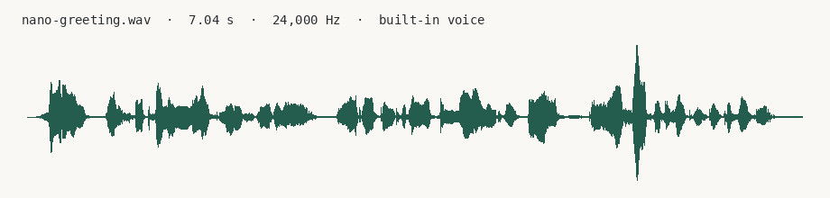
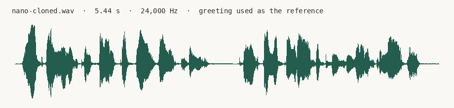
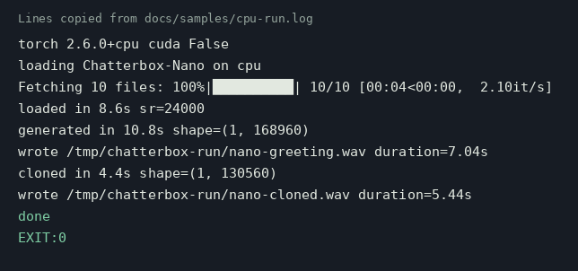

# Chatterbox TTS by Transformaiton.com

Chatterbox is an open-source text-to-speech and voice-cloning model. You give it a sentence, and it speaks. Give it a short recording as well, and it speaks in that voice.

This repository is [Transformaiton.com](https://transformaiton.com/)'s public copy of the MIT-licensed project [resemble-ai/chatterbox](https://github.com/resemble-ai/chatterbox). Transformaiton.com is an AI consultancy for small businesses. We wrote this guide so a shop, clinic, tutor, or agency can install the model and produce audio without reading research notes first.

**Modifications by Transformaiton.com.** This copy changes documentation only: this README, [docs/INSTALL.md](docs/INSTALL.md), [docs/USAGE.md](docs/USAGE.md), and [docs/ORIGINAL.md](docs/ORIGINAL.md), which keeps the upstream README. CPU recordings from preparing this guide are in `docs/samples`. The Python model code is the upstream code. The [LICENSE](LICENSE) file is unchanged, and the copyright stays with Resemble AI (Copyright (c) 2025 Resemble AI).

Transformaiton.com is not affiliated with or endorsed by Resemble AI.

The upstream README says that as of August 2026 Chatterbox is retired research and is no longer maintained by Resemble AI. This guide tells you how to run the public model. It does not add a paid voice service.


These two pictures are the banner images already in the repository. They were published with the upstream project and show the Chatterbox name together with the Resemble AI mark. Transformaiton.com did not create them.

## Recorded on a CPU

On 16 November 2026 this copy was run on a Linux machine with 4 CPU cores and no NVIDIA GPU. The environment was Python 3.12.3 and PyTorch 2.6.0+cpu. `torch.cuda.is_available()` was false. A check with `perth.PerthImplicitWatermarker` returned `1.0` for the Nano greeting, the Nano clone, the English greeting, and the English clone.

**Chatterbox-Nano** (`device="cpu"`, `nano=True`), the model upstream aimed at CPUs. The loader finished in 8.6 seconds, including the download of 10 files from `ResembleAI/chatterbox-nano`. The built-in voice then took 10.8 seconds to render 7.04 seconds of audio. A second call passed that file back in as `audio_prompt_path` and took 4.4 seconds to render 5.44 seconds. The reference is the model's own output, so this is the clone call running on the voice shipped in the checkpoint.

The spoken lines were: "Hello, thanks for calling Northwind Studio. We are open today from nine until five, and we are happy to help you book a visit." and "Your appointment is confirmed for Thursday at two. Please bring a photo of the piece you want us to match." Northwind Studio is only the name in that test sentence.







The still above, and the [animated GIF](docs/samples/cpu-run.gif), are result lines copied from [docs/samples/cpu-run.log](docs/samples/cpu-run.log) and drawn in a terminal style. Progress-bar redraws are left in the log and are not drawn. This is not a screen recording.

- [Nano greeting, MP3](docs/samples/nano-greeting.mp3) (7.04 s, encoded from the WAV the model wrote)
- [Nano clone, MP3](docs/samples/nano-cloned.mp3) (5.44 s)
- [Raw log](docs/samples/cpu-run.log)

**English Chatterbox**, the model in the quick-start script (`ChatterboxTTS.from_pretrained(device="cpu")`). The loader finished in 15.7 seconds. The line "Hello, thanks for calling. We are open today from nine until five." took 10.2 seconds to render 4.00 seconds of audio. A clone call that used the Nano greeting above as `audio_prompt_path` took 10.0 seconds and wrote 3.80 seconds. Log: [docs/samples/english-run.log](docs/samples/english-run.log).

- [English greeting, MP3](docs/samples/english-greeting.mp3)
- [English clone, MP3](docs/samples/english-cloned.mp3)

On this 4-core CPU, a short line took longer to render than it takes to play. That matches a CPU run of these model sizes. It is a separate figure from upstream's report of about 3× faster than realtime for Nano on 8 cores.

## What a small business can do with it

- **Voiceovers.** Turn a script into narration for an ad, a website explainer, or a social post.
- **Phone greetings.** Record an open/closed message or an on-hold line without booking a studio.
- **Videos and courses.** Narrate a lesson, a product demo, or a training clip, then drop the audio into your editor.
- **Multilingual audio.** The multilingual model speaks more than twenty languages from the same install, which helps when customers do not share one language.

The spoken result is a WAV file at 24,000 Hz. You can play it, or place it on a timeline in a video editor.

Clone a voice only when you own it or have permission to use it. A client voice, a staff voice, and a celebrity voice all need that permission. See [Voices you are allowed to clone](#voices-you-are-allowed-to-clone).

## Pick a model

The code downloads weights from Hugging Face the first time you run a model. Keep these repository names. They are the addresses the program requests.

| Model | What it is good at | Languages | Hardware | Hugging Face repository the code downloads |
| --- | --- | --- | --- | --- |
| Chatterbox (original) | General English speech, with controls for pace and expressiveness. A built-in voice is included, and a short sample can replace it. | English | CPU, NVIDIA GPU (`cuda`), or Apple Silicon (`mps`) | [`ResembleAI/chatterbox`](https://huggingface.co/ResembleAI/chatterbox) |
| Chatterbox-Nano | The same family, built for machines without a strong GPU. Upstream reports about 3× faster than realtime on 8 CPU cores. | English | CPU is the intended target | [`ResembleAI/chatterbox-nano`](https://huggingface.co/ResembleAI/chatterbox-nano) |
| Chatterbox-Turbo | English speech with less compute than the 500M models, plus short paralinguistic tags such as `[chuckle]` and `[laugh]`. | English | NVIDIA GPU is what the included example uses. CPU and Apple Silicon are accepted by the loader. | [`ResembleAI/chatterbox-turbo`](https://huggingface.co/ResembleAI/chatterbox-turbo) |
| Chatterbox Multilingual V3 | One voice model across many languages. Upstream describes it as the current multilingual checkpoint: same 0.5B size, steadier speaker match, fewer stray phrases. | 23 languages listed [below](#languages) | Same device choices as the English model. Heavier than Nano. | [`ResembleAI/chatterbox`](https://huggingface.co/ResembleAI/chatterbox), file `t3_mtl23ls_v3.safetensors` |

Parameter counts published upstream: original and multilingual about 500M, Turbo about 350M, Nano about 110M.

Single-language finetunes are published separately. Their model-card names are listed in the [original project documentation](docs/ORIGINAL.md#single-language-pack). The Python in this repository loads multilingual speech from `ResembleAI/chatterbox`, not from those separate cards.

Files the English loader requests from `ResembleAI/chatterbox`:

- `ve.safetensors`
- `t3_cfg.safetensors` (about 2.1 GB)
- `s3gen.safetensors` (about 1.1 GB)
- `tokenizer.json`
- `conds.pt` (the built-in voice)

Nano loads `t3_nano_v1.safetensors` (about 0.87 GB) and `s3gen_meanflow.safetensors` (about 1.1 GB) from `ResembleAI/chatterbox-nano`. Turbo loads `t3_turbo_v1.safetensors` (about 1.9 GB) and the same meanflow file from `ResembleAI/chatterbox-turbo`. Those two loaders also download every `.safetensors` file in the repository, including an extra `s3gen.safetensors` of about 1.1 GB.

Multilingual V3 loads `t3_mtl23ls_v3.safetensors` (about 2.1 GB), `s3gen.pt` (about 1.1 GB), `ve.pt`, `grapheme_mtl_merged_expanded_v1.json`, `conds.pt`, and `Cangjie5_TC.json`. Passing `t3_model="v2"`, or omitting it, loads `t3_mtl23ls_v2.safetensors` instead.

## CPU or GPU

You can run this on a normal computer. A GPU makes the larger models faster. It is not required for a first greeting.

| Your machine | Practical choice |
| --- | --- |
| No NVIDIA GPU, including most office PCs and many laptops | Start with **Chatterbox-Nano** and `device="cpu"`. Upstream's figure is about 3× faster than realtime on 8 CPU cores. Fewer cores still run; a short greeting takes longer. The original English model and Multilingual V3 also accept `device="cpu"`. Their weight files are larger, so the same sentence takes longer and uses more memory. |
| NVIDIA GPU | Use `device="cuda"`. Turbo is the lower-compute English model (upstream: less compute and VRAM than the earlier 500M models). A specific VRAM number is not published in this repository. If the process runs out of memory, use Nano. |
| Apple Silicon Mac (M1 or newer) | Use `device="mps"`. The included `example_for_mac.py` is the project's Mac example. Intel Macs use the CPU. |

Memory follows the weight files. Nano's loaded checkpoints are a bit under 2 GB, and the English model's loaded checkpoints are about 3.2 GB, before PyTorch and the generation workspace. A machine with 16 GB of RAM is a sensible starting point for a CPU run. An 8 GB machine can run out of memory once the weights are loaded. Leave about 10 GB of free disk for the Python packages plus the model you actually download. Downloaded weights are cached under your home folder in `.cache/huggingface`.

Upstream developed and tested this project on Python 3.11 and Debian 11. This repository accepts Python 3.10 and newer (`requires-python` in `pyproject.toml`).

## Install

Full click-by-click steps for each system are in [docs/INSTALL.md](docs/INSTALL.md). Short version, from a terminal:

```bash
git clone https://github.com/Transformaiton/chatterbox.git
cd chatterbox
python3 -m venv .venv
source .venv/bin/activate          # Windows: .venv\Scripts\activate
python -m pip install -U pip
pip install -e .
```

On Windows, install Python 3.11 from [python.org](https://www.python.org/downloads/) and Git from [git-scm.com](https://git-scm.com/download/win) first, then use `py -3.11 -m venv .venv`. `pip install chatterbox-tts` installs the published package from PyPI. The steps above install the code in this copy, which is the copy this guide describes.

You need Git on your PATH either way. One dependency (`resemble-perth`) is installed from a Git repository.

## Quick start

Save the following as `quickstart.py` inside the cloned folder, with the virtual environment activated. It writes `greeting.wav` in the built-in voice, then, when you supply a recording you are allowed to use, writes `cloned.wav` in that voice.

```python
"""Generate a greeting, then clone a voice from a short sample you have permission to use."""

import sys
from pathlib import Path

import torch
import torchaudio as ta
from chatterbox.tts import ChatterboxTTS

if torch.cuda.is_available():
    device = "cuda"
elif torch.backends.mps.is_available():
    device = "mps"
else:
    device = "cpu"

print(f"Using device: {device}")
print("Loading the English Chatterbox model. The first run downloads a few gigabytes.")

model = ChatterboxTTS.from_pretrained(device=device)

text = (
    "Hello, thanks for calling. We are open today from nine until five, "
    "and we are happy to help you find the right service."
)

greeting = model.generate(text)
ta.save("greeting.wav", greeting, model.sr)
print(f"Wrote greeting.wav at {model.sr} Hz, using the built-in voice.")

sample = Path(sys.argv[1]) if len(sys.argv) > 1 else Path("voice-sample.wav")
if not sample.is_file():
    print("No voice sample found, so no clone was written.")
    print("When you have a short WAV of a voice you own or may use, run:")
    print("  python quickstart.py path/to/your-sample.wav")
    sys.exit(0)

cloned = model.generate(text, audio_prompt_path=str(sample))
ta.save("cloned.wav", cloned, model.sr)
print(f"Wrote cloned.wav using the voice in {sample}.")
```

```bash
python quickstart.py
python quickstart.py path/to/your-sample.wav
```

The first run downloads `ResembleAI/chatterbox` and can take several minutes on a modest connection. Later runs reuse the cache. On a CPU, generating one greeting can take longer than the audio itself. That is expected for the 500M English model. For a quicker CPU test, use Nano as shown in [docs/USAGE.md](docs/USAGE.md).

More examples already in the repository:

| File | What it runs |
| --- | --- |
| `example_tts.py` | English speech, then a French line from the multilingual model |
| `example_for_mac.py` | English speech on Apple Silicon |
| `example_tts_turbo.py` | Turbo, including a `[chuckle]` tag |
| `example_tts_nano.py` | Nano |
| `example_vc.py` | Voice conversion from one recording onto another voice |
| `gradio_tts_app.py`, `gradio_tts_turbo_app.py`, `gradio_vc_app.py`, `multilingual_app.py` | Browser pages. Read the note in [docs/USAGE.md](docs/USAGE.md) before opening them: two of the apps request a temporary public link. |

## Voices you are allowed to clone

Only clone a voice you own, or a voice whose owner has given you permission.

A clean 5 to 10 seconds of one person speaking, with little background noise, is the useful kind of sample. Turbo and Nano reject a reference shorter than 5 seconds. The original English model and the multilingual model accept a short clip and use up to about 10 seconds of it.

Permission is separate from the software license. The MIT license covers the code. It does not give you the right to copy a person's voice.

## The audio carries a Perth watermark

Every clip this model writes includes Resemble AI's Perth watermark (Perceptual Threshold). Upstream describes it as an imperceptible neural watermark that survives MP3 compression, audio editing, and common manipulations, with nearly 100% detection accuracy. The library is [resemble-ai/perth](https://github.com/resemble-ai/perth), which this project already depends on. A short script to check a file is in [docs/USAGE.md](docs/USAGE.md#watermark-check).

## Troubleshooting and FAQ

**The install stops while fetching `resemble-perth`.** Install Git, confirm `git --version` works in the same terminal, and run `pip install -e .` again.

**`No module named chatterbox`.** The virtual environment is not active, or `pip install -e .` was not run from the repository folder. Activate `.venv`, then install again.

**The first run sits on a download.** The English weights are a few gigabytes from `ResembleAI/chatterbox`. Leave it running. If a corporate network blocks Hugging Face, the download cannot finish until that host is allowed. A failed Xet download is retried over ordinary HTTPS by the Turbo and Nano loaders.

**The process is killed, or CUDA reports out of memory.** Close other apps and use Nano with `device="cpu"`. The larger checkpoints need more RAM than their file size, because PyTorch holds the weights and the workspace together.

**Apple Silicon raises an error while loading weights.** Run `python example_for_mac.py` after you set `AUDIO_PROMPT_PATH` in that file to a real WAV. That example sends tensors to the Mac GPU with a `map_location` patch.

**`Audio prompt must be longer than 5 seconds!`** Turbo and Nano require that. Record a little more speech, or use the original English model for a shorter sample.

**The cloned voice still sounds like the sample's accent in another language.** Use a reference clip in the language you are generating. Upstream's tip for language transfer is to set `cfg_weight` to `0`.

**Turbo ignores exaggeration.** Turbo and Nano log a warning and ignore `cfg_weight`, `min_p`, and `exaggeration`. Those controls apply to the original English model and the multilingual model. Defaults that upstream recommends are `exaggeration=0.5` and `cfg_weight=0.5`. For more dramatic speech, try `exaggeration` around `0.7` and `cfg_weight` around `0.3`.

**I need a browser instead of a script.** `python gradio_tts_app.py` opens a local page and also requests a public Gradio link (`share=True` in that file). Use it on a machine you trust, and stop the program when you are done. Details are in [docs/USAGE.md](docs/USAGE.md).

**Where did the WAV go?** The script writes it in the current folder. This repository's `.gitignore` ignores `*.wav`, so Git will not pick the file up unless you force-add it.

**Can we sell videos that use this audio?** The code is MIT licensed, provided the copyright notice stays with the software. Voice consent and local publicity or impersonation law are separate questions. This guide is not legal advice.

**Who do we call when a step fails?** Write to Transformaiton.com. The upstream project, as its own README states, is unmaintained research and does not offer a support tier.

Install fixes for Windows, Mac, and Linux are collected in [docs/INSTALL.md](docs/INSTALL.md). Day-to-day generation options are in [docs/USAGE.md](docs/USAGE.md).

## Contact

Transformaiton.com helps small businesses install and use practical AI.

- Website: [https://transformaiton.com/](https://transformaiton.com/)
- Email: [info@transformaiton.com](mailto:info@transformaiton.com)
- GitHub: [https://github.com/Transformaiton](https://github.com/Transformaiton)

## Credits

- Original project: [resemble-ai/chatterbox](https://github.com/resemble-ai/chatterbox)
- License: MIT. Copyright (c) 2025 Resemble AI. The full text is in [LICENSE](LICENSE), which this copy does not change.
- Transformaiton.com is not affiliated with or endorsed by Resemble AI.
- **Modifications by Transformaiton.com:** customer documentation (this README, `docs/INSTALL.md`, `docs/USAGE.md`, and `docs/ORIGINAL.md`) and the CPU recordings in `docs/samples`. The model and application Python files are unchanged.
- Watermark library: [resemble-ai/perth](https://github.com/resemble-ai/perth)
- Upstream also credits Podonos, CosyVoice, Real-Time-Voice-Cloning, HiFT-GAN, Llama 3, and S3Tokenizer. Those notes, the citation, and the evaluation write-ups stay in the [original project documentation](docs/ORIGINAL.md).

If you cite the model, cite the upstream authors:

```
@misc{chatterboxtts2025,
  author       = {{Resemble AI}},
  title        = {{Chatterbox-TTS}},
  year         = {2025},
  howpublished = {\url{https://github.com/resemble-ai/chatterbox}},
  note         = {GitHub repository}
}
```

## Languages

Arabic (`ar`), Danish (`da`), German (`de`), Greek (`el`), English (`en`), Spanish (`es`), Finnish (`fi`), French (`fr`), Hebrew (`he`), Hindi (`hi`), Italian (`it`), Japanese (`ja`), Korean (`ko`), Malay (`ms`), Dutch (`nl`), Norwegian (`no`), Polish (`pl`), Portuguese (`pt`), Russian (`ru`), Swedish (`sv`), Swahili (`sw`), Turkish (`tr`), Chinese (`zh`).

## Original project documentation

The upstream README, including model-zoo tables, demo links, single-language model cards, watermark extraction, and the citation, is preserved in [docs/ORIGINAL.md](docs/ORIGINAL.md).

That file still contains the upstream project's own links. Those links are not Transformaiton.com pages. Model download names in this guide match the names in the code: `ResembleAI/chatterbox`, `ResembleAI/chatterbox-turbo`, and `ResembleAI/chatterbox-nano`.
